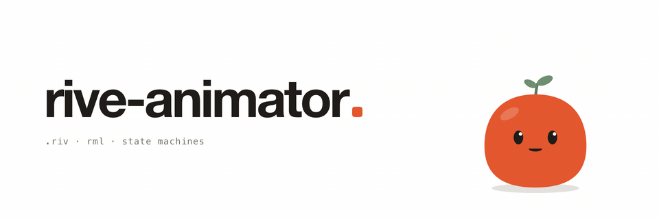
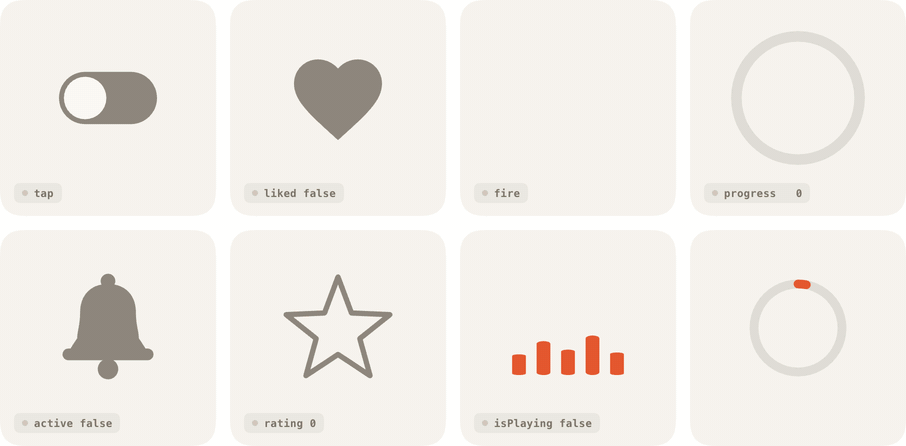

<div align="center">

<picture>
  <source media="(prefers-color-scheme: dark)" srcset="assets/hero-dark.gif">
  
</picture>

Rive files that work before they ship, and feel alive when they do. A code-first toolkit for AI coding agents and developers: nine recipes recorded in the real runtime, a motion baker, an SVG and Lottie converter, a linter for the traps that build clean, and copy-paste wiring for eight platforms.

[](LICENSE)
[](https://code.claude.com/docs)
[](https://antigravity.google)
[](https://rive.app)
[](tests/)

English · [Español](README.es.md) · [中文](README.zh-CN.md)

</div>

## Why

A `.riv` is a compiled program, not an image, and when it goes wrong it says nothing. It builds and loads with an input nothing reads, a state with no way back, a pose it snaps to, a loop that pops at its seam, or a rotation in degrees that spins fifty-seven times. Or it works and feels dead: every part moves in sync, every pose stops cold, colours swap instead of blending, and nothing breathes between actions.

`rive-animator` lints for most of the first kind before you touch production code, renders the rest (a state with no way back only shows when you click twice), and gives your agent a method for the second.

## Recipes

<picture>
  <source media="(prefers-color-scheme: dark)" srcset="assets/recipes-dark.gif">
  
</picture>

Every frame above is the real `@rive-app/canvas-advanced` runtime driven by scripted inputs; the chip shows the input as your app would set it.

| Recipe | Inputs | What it teaches |
|---|---|---|
| [Living Mascot](examples/living-mascot/build.py) | `lookX` number, `poke` trigger | Four layers at once: breath, blinks, a gaze blend, a hop with squash, stretch and follow-through |
| [Toggle Switch](examples/toggle-switch/scene.rml) | `tap` trigger, click listener | Pose states with a 240 ms mix; the knob stretches with its travel |
| [Like Button](examples/like-heart/scene.rml) | `liked` boolean | Anticipation, pop and settle in one flow; a seeded spark burst; a faster exit |
| [Success Check](examples/success-check/scene.rml) | `fire` trigger | In from 0.92 with opacity, the check drawn on; a second fire returns to rest |
| [Progress Ring](examples/progress-ring/scene.rml) | `progress` number, 0–100 | A blend state on the value; completion as its own layer |
| [Tab Bar Bell](examples/tab-bar-item/scene.rml) | `active` boolean, `tap` trigger | A hinge swing with a clapper that follows a beat late |
| [Rating Star](examples/rating-star/scene.rml) | `rating` number | Outline to fill, a 72° twist that never rewinds, sparks on rays |
| [Audio Equalizer](examples/audio-equalizer/scene.rml) | `isPlaying` boolean | Five bars on seeded wave pairs that never sync |
| [Spinner Loader](examples/spinner-loader/scene.rml) | none | A trim chase that closes its loop in three cycles |

## Make it alive

The motion method is [rossark-motion-skill](https://github.com/rossark0/rossark-motion-skill) translated to RML, in [references/living-motion.md](references/living-motion.md): never teleport, small amplitudes on two strong curves, parts that turn around their real pivots, follow-through by delay rather than springs, seeded variety, one main action plus idle loops that never stop.

Rive eases each keyframe segment on its own, so a chain of poses stops dead at every key. `scripts/motion_keys.py` fixes that: `flow` passes through every pose without stopping or overshooting, written as exact `cubicValue` Hermite segments (measured against the renderer to a quarter pixel), and `bake` turns breathing, sway and follow-through into keyframes that close their loop.

```bash
python3 scripts/motion_keys.py flow 0:1 9:0.86 15:1.1 44:0.8 52:1.04 76:1   # crouch, stretch, squash, settle
python3 scripts/motion_keys.py track 0:1 7:0.1 9:0.1 20:1:out               # a blink, 7 / 2 / 11 frames
python3 scripts/motion_keys.py wave --base 1 --amp 0.016 --period 120 --length 240
```

## What to ask your assistant

| Say | What happens |
|---|---|
| *"Make a mascot in Rive that breathes, blinks and hops when clicked"* | Starts from `living-mascot`, keeps every number in tokens, renders contact sheets before calling it done |
| *"This toggle snaps between states"* | Lints for `RML012`, adds a mix to the pose transitions, blends the colour |
| *"Convert this SVG logo into an interactive Rive artboard"* | Runs `svg2rml.py`, adds a state machine, verifies with the Rive CLI |
| *"My Rive animation draws but ignores clicks"* | Runs `rive_lint.py`, finds the missing listener or the dead input, prints exact wiring |
| *"Give me Flutter wiring for mascot.riv"* | `rive_lint.py mascot.riv -f flutter` |

## Toolchain

Python 3.8+, standard library only.

| Script | Does |
|---|---|
| `scripts/motion_keys.py` | Bakes `track`, `flow` and `wave` channels into RML keyframes |
| `scripts/rml_lint.py` | Pre-flight checks: degrees, colour keys, dead inputs, snaps to poses, loop seams |
| `scripts/rive_lint.py` | Reads a `.riv`: artboards, machines, inputs, listeners, defects, wiring for 8 platforms |
| `scripts/svg2rml.py` / `lottie2rml.py` | SVG or Lottie to RML with detached cubic vertices |
| `scripts/make-gifs.mjs` | Records the README images in the real runtime at 50 fps, seamless loops, light and dark |

Wiring: React (`@rive-app/react-canvas`), Vue 3, Svelte, vanilla Web Canvas, Flutter, SwiftUI, Android Kotlin and React Native. See [references/universal-framework-wiring.md](references/universal-framework-wiring.md).

## Defect ledger

| Code | Catches | Fix |
|---|---|---|
| `RML011` | An input declared that no condition, listener or blend reads | Wire it, or delete it |
| `RML012` | A transition into a one-frame pose with no mix: it snaps | `duration="160"`–`"300"` and a cubic interpolator |
| `RML013` | A `loop` whose last key differs from its first: it pops | Close the loop, or `pingPong` |
| `RML004` | Rotation in degrees | Radians: a full turn is `6.2831853` |
| `RML007` / `RML008` | A fill with no paint; a double keyed on a colour | Add `<SolidColor>`; use `KeyFrameColor` |
| `RV001`–`RV012` | Binary defects: truncated file, no artboard, 0×0, no layers, duplicate or padded input names | See [references/defect-ledger.md](references/defect-ledger.md) |

## Installation

```bash
claude plugin add obeskay/rive-animator-skill                                            # Claude Code
git clone https://github.com/obeskay/rive-animator-skill.git ~/.gemini/config/skills/rive-animator   # Antigravity
```

To work on it:

```bash
git clone https://github.com/obeskay/rive-animator-skill.git && cd rive-animator-skill
npm install && npm test
npm run build:examples && npm run gifs   # needs the Rive CLI, ffmpeg and Chrome
```

## License

MIT © [ov (obeskay)](https://github.com/obeskay). The motion method credits [rossark0/rossark-motion-skill](https://github.com/rossark0/rossark-motion-skill) (MIT).
